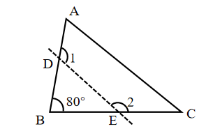
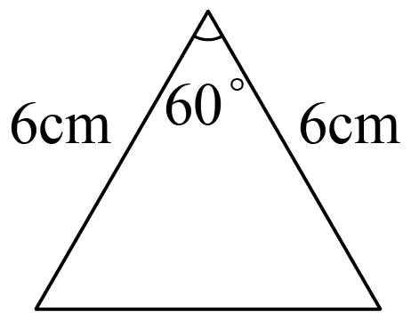

# AVP0658 — Single visual target

We-Math:1310 / We-Math:175 · same type · Geometric markers

## Shared or similar visual information

A short circular arc drawn between rays near their common vertex.

## Evidence locations

- Left image: The arc beside the numeral 1 at the crossing of the dashed line and the left side.
- Right image: The arc beneath the apex, beside 60 degrees.

## Mathematical meanings

Left image: It identifies the selected angle labeled 1 at the left crossing. Right image: It identifies the apex angle with measure 60 degrees.

## Same mathematical meanings

yes

## Rationales

Each short arc is placed inside the wedge it selects. This use attaches an angle label to the relevant rays or identifies the marked vertex angle.

Only the selected target is annotated. AI visual-review draft; not independently double-annotated by humans.
