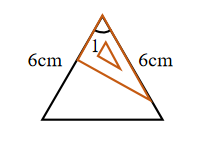
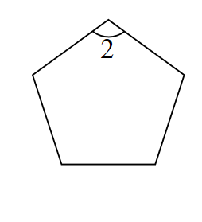

# AVP0659 — Single visual target

We-Math:1146 / We-Math:240 · same type · Geometric markers

## Shared or similar visual information

A short circular arc drawn between rays near their common vertex.

## Evidence locations

- Left image: The small arc just below the top vertex of the orange-edged triangle.
- Right image: The arc beside the numeral 2 at the top vertex of the pentagon.

## Mathematical meanings

Left image: It identifies angle 1 at the top vertex. Right image: It identifies the interior angle labeled 2 at the top vertex.

## Same mathematical meanings

yes

## Rationales

Each short arc is placed inside the wedge it selects. This use attaches an angle label to the relevant rays or identifies the marked vertex angle.

Only the selected target is annotated. AI visual-review draft; not independently double-annotated by humans.
