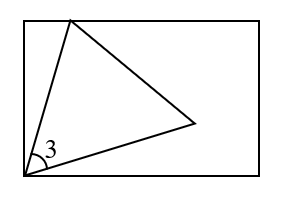
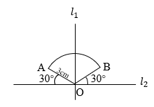

# AVP0660 — Single visual target

We-Math:1179 / We-Math:1363 · same type · Geometric markers

## Shared or similar visual information

A short circular arc drawn between rays near their common vertex.

## Evidence locations

- Left image: The arc labeled 3 in the lower-left corner of the rectangle.
- Right image: The small arc beside the 30-degree label to the right of O.

## Mathematical meanings

Left image: It identifies the angle between the triangle sides meeting at the lower-left corner. Right image: It identifies the angle between OB and the rightward ray of line l2.

## Same mathematical meanings

yes

## Rationales

Each short arc is placed inside the wedge it selects. This use attaches an angle label to the relevant rays or identifies the marked vertex angle.

Only the selected target is annotated. AI visual-review draft; not independently double-annotated by humans.
