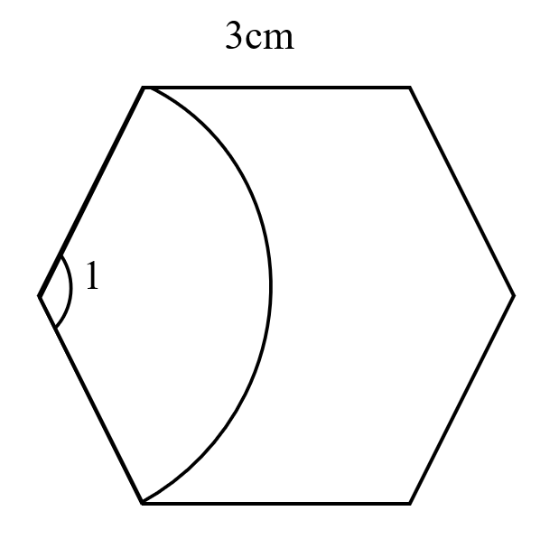
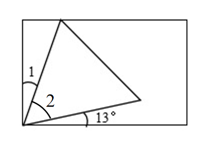

# AVP0661 — Single visual target

We-Math:1186 / We-Math:177 · same type · Geometric markers

## Shared or similar visual information

A short circular arc drawn between rays near their common vertex.

## Evidence locations

- Left image: The small arc beside the numeral 1 at the left corner of the polygon.
- Right image: The arc beside 13 degrees near the lower-left rectangle corner.

## Mathematical meanings

Left image: It identifies the selected angle labeled 1 at that polygon vertex. Right image: It identifies the angle between the low sloping side and the bottom horizontal ray.

## Same mathematical meanings

yes

## Rationales

Each short arc is placed inside the wedge it selects. This use attaches an angle label to the relevant rays or identifies the marked vertex angle.

Only the selected target is annotated. AI visual-review draft; not independently double-annotated by humans.
