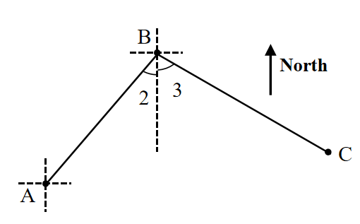
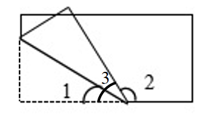

# AVP0662 — Single visual target

We-Math:43 / We-Math:228 · same type · Geometric markers

## Shared or similar visual information

A short circular arc drawn between rays near their common vertex.

## Evidence locations

- Left image: The small arc beside the numeral 2 at B, on the left of the vertical dashed guide.
- Right image: The arc beside numeral 2 immediately to the right of the shared bottom vertex.

## Mathematical meanings

Left image: It identifies angle 2 between BA and the vertical reference at B. Right image: It identifies the selected angle labeled 2 at that vertex.

## Same mathematical meanings

yes

## Rationales

Each short arc is placed inside the wedge it selects. This use attaches an angle label to the relevant rays or identifies the marked vertex angle.

Only the selected target is annotated. AI visual-review draft; not independently double-annotated by humans.
