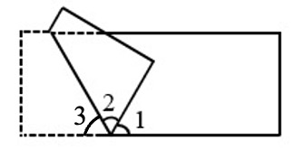
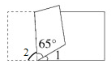

# AVP0663 — Single visual target

We-Math:412 / We-Math:415 · same type · Geometric markers

## Shared or similar visual information

A short circular arc drawn between rays near their common vertex.

## Evidence locations

- Left image: The arc beside numeral 1 to the right of the common bottom vertex.
- Right image: The arc beside numeral 1 to the right of the bottom vertex.

## Mathematical meanings

Left image: It identifies the angle labeled 1 between the tilted side and the rightward base ray. Right image: It identifies the angle labeled 1 between the tilted side and the rightward base ray.

## Same mathematical meanings

yes

## Rationales

Each short arc is placed inside the wedge it selects. This use attaches an angle label to the relevant rays or identifies the marked vertex angle.

Only the selected target is annotated. AI visual-review draft; not independently double-annotated by humans.
