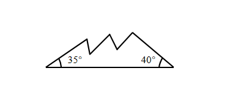
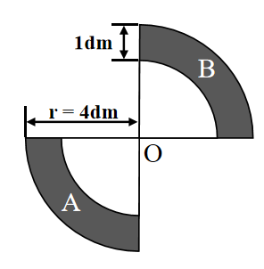

# AVP0664 — Single visual target

We-Math:1300 / We-Math:94 · same type · Geometric markers

## Shared or similar visual information

A curved arc-shaped stroke.

## Evidence locations

- Left image: The small arc beside the 35-degree label at the left end of the jagged figure.
- Right image: The outer curve of the upper-right dark region labeled B.

## Mathematical meanings

Left image: It identifies the vertex angle assigned the 35-degree measure. Right image: It is the outer circular boundary of a quarter-annular region.

## Same mathematical meanings

no

## Rationales

The short arc on the left singles out a wedge between incident rays. The curve on the right is part of the depicted shape or path. It is the outer circular boundary of a quarter-annular region.

Only the selected target is annotated. AI visual-review draft; not independently double-annotated by humans.
