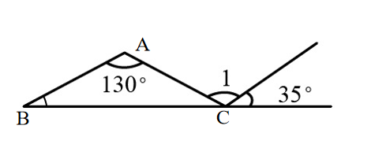
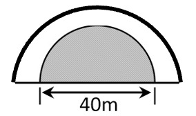

# AVP0665 — Single visual target

We-Math:1303 / We-Math:119 · same type · Geometric markers

## Shared or similar visual information

A curved arc-shaped stroke.

## Evidence locations

- Left image: The arc beside the 130-degree label below vertex A.
- Right image: The thick black semicircular arc over the smaller gray semicircle.

## Mathematical meanings

Left image: It identifies the angle at A assigned the 130-degree measure. Right image: It is the outer boundary of the larger semicircle.

## Same mathematical meanings

no

## Rationales

The short arc on the left singles out a wedge between incident rays. The curve on the right is part of the depicted shape or path. It is the outer boundary of the larger semicircle.

Only the selected target is annotated. AI visual-review draft; not independently double-annotated by humans.
