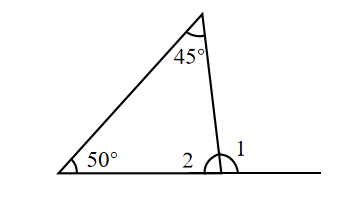
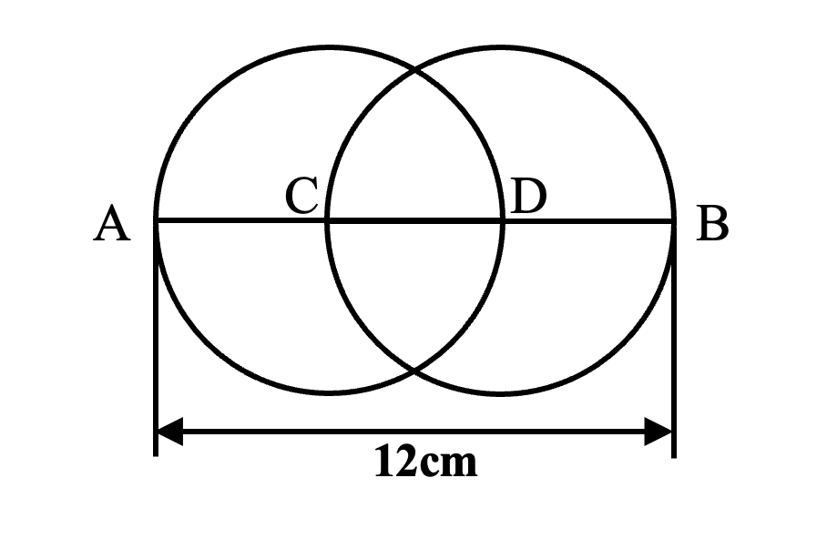

# AVP0666 — Single visual target

We-Math:1306 / We-Math:123 · same type · Geometric markers

## Shared or similar visual information

A curved arc-shaped stroke.

## Evidence locations

- Left image: The arc at the top vertex beside the 45-degree label.
- Right image: The upper semicircular part of the left circle between A and D.

## Mathematical meanings

Left image: It identifies the apex angle with measure 45 degrees. Right image: It forms part of the circumference of the left circle.

## Same mathematical meanings

no

## Rationales

The short arc on the left singles out a wedge between incident rays. The curve on the right is part of the depicted shape or path. It forms part of the circumference of the left circle.

Only the selected target is annotated. AI visual-review draft; not independently double-annotated by humans.
