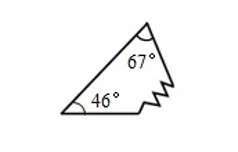
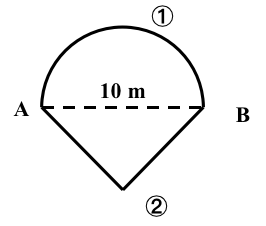

# AVP0667 — Single visual target

We-Math:1308 / We-Math:1385 · same type · Geometric markers

## Shared or similar visual information

A curved arc-shaped stroke.

## Evidence locations

- Left image: The small arc next to the 67-degree label at the top.
- Right image: The upper arc from A to B over the dashed horizontal segment.

## Mathematical meanings

Left image: It identifies the angle at the top vertex assigned the 67-degree measure. Right image: It is the semicircular boundary of region 1 in the composite figure.

## Same mathematical meanings

no

## Rationales

The short arc on the left singles out a wedge between incident rays. The curve on the right is part of the depicted shape or path. It is the semicircular boundary of region 1 in the composite figure.

Only the selected target is annotated. AI visual-review draft; not independently double-annotated by humans.
