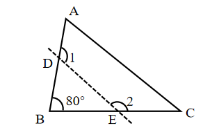
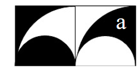

# AVP0668 — Single visual target

We-Math:1310 / We-Math:110 · same type · Geometric markers

## Shared or similar visual information

A curved arc-shaped stroke.

## Evidence locations

- Left image: The arc beside the numeral 1 at the crossing of the dashed line and the left side.
- Right image: The curved edge of the dark lower-left half disk.

## Mathematical meanings

Left image: It identifies the selected angle labeled 1 at the left crossing. Right image: It is the semicircular boundary of the dark region.

## Same mathematical meanings

no

## Rationales

The short arc on the left singles out a wedge between incident rays. The curve on the right is part of the depicted shape or path. It is the semicircular boundary of the dark region.

Only the selected target is annotated. AI visual-review draft; not independently double-annotated by humans.
