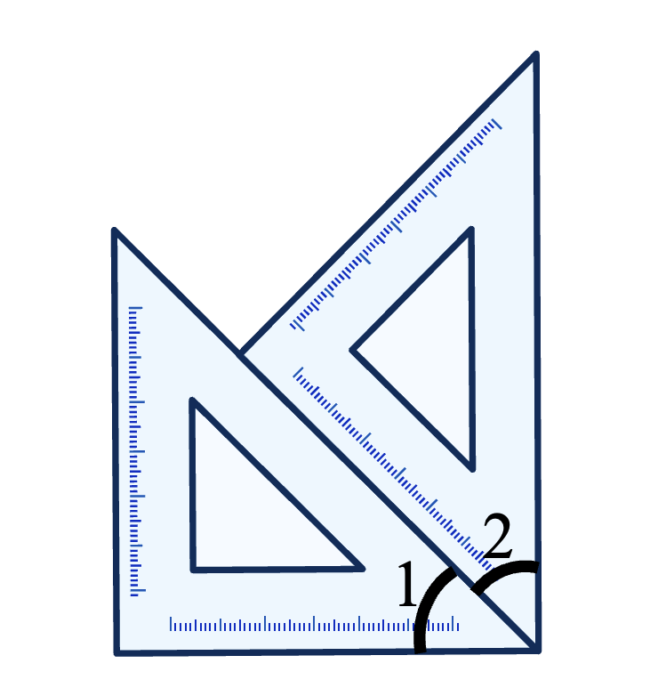
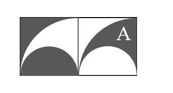

# AVP0669 — Single visual target

We-Math:1170 / We-Math:101 · same type · Geometric markers

## Shared or similar visual information

A curved arc-shaped stroke.

## Evidence locations

- Left image: The arc beside the numeral 2 near the lower-right corner of the superimposed rulers.
- Right image: The upper arc of the smaller gray half disk on the left.

## Mathematical meanings

Left image: It identifies the wedge labeled angle 2 at the ruler intersection. Right image: It forms the semicircular boundary of the filled half disk.

## Same mathematical meanings

no

## Rationales

The short arc on the left singles out a wedge between incident rays. The curve on the right is part of the depicted shape or path. It forms the semicircular boundary of the filled half disk.

Only the selected target is annotated. AI visual-review draft; not independently double-annotated by humans.
