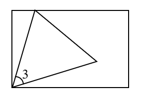
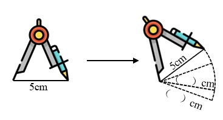

# AVP0670 — Single visual target

We-Math:1179 / We-Math:122 · same type · Geometric markers

## Shared or similar visual information

A curved arc-shaped stroke.

## Evidence locations

- Left image: The arc labeled 3 in the lower-left corner of the rectangle.
- Right image: The dashed curved stroke at the right of the rotated compass.

## Mathematical meanings

Left image: It identifies the angle between the triangle sides meeting at the lower-left corner. Right image: It shows a circular trace drawn by rotating the compass.

## Same mathematical meanings

no

## Rationales

The short arc on the left singles out a wedge between incident rays. The curve on the right is part of the depicted shape or path. It shows a circular trace drawn by rotating the compass.

Only the selected target is annotated. AI visual-review draft; not independently double-annotated by humans.
