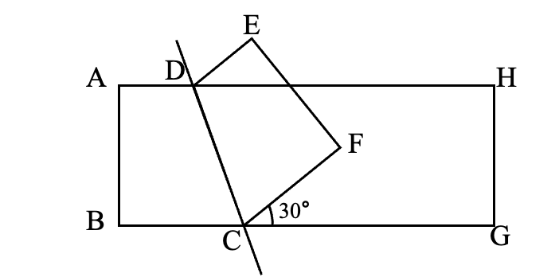
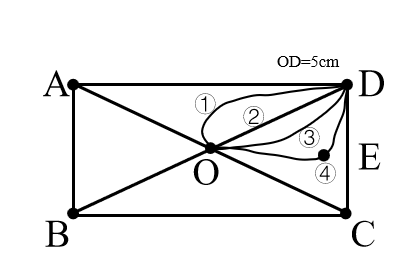

# AVP0671 — Single visual target

We-Math:1364 / We-Math:512 · same type · Geometric markers

## Shared or similar visual information

A curved arc-shaped stroke.

## Evidence locations

- Left image: The small arc beside the 30-degree label where the folded polygon meets the lower side at C.
- Right image: The uppermost curved connection from O toward D, beside the circled 1.

## Mathematical meanings

Left image: It identifies the 30-degree angle between CF and the rightward base ray. Right image: It is one drawn candidate path between the labeled points O and D.

## Same mathematical meanings

no

## Rationales

The short arc on the left singles out a wedge between incident rays. The curve on the right is part of the depicted shape or path. It is one drawn candidate path between the labeled points O and D.

Only the selected target is annotated. AI visual-review draft; not independently double-annotated by humans.
