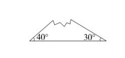
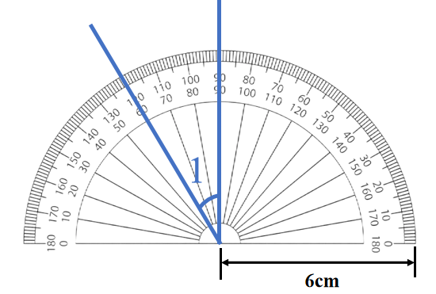

# AVP0672 — Single visual target

We-Math:1301 / We-Math:347 · same type · Geometric markers

## Shared or similar visual information

An arc curved around an angle vertex or center.

## Evidence locations

- Left image: The arc next to the 30-degree label at the right base vertex.
- Right image: The large gray semicircular outer rim with degree markings.

## Mathematical meanings

Left image: It identifies the vertex angle assigned the 30-degree measure. Right image: It carries the angular scale of the protractor.

## Same mathematical meanings

no

## Rationales

The left arc isolates one selected vertex angle. The right arc carries many scale graduations, so it provides an instrument for reading different angular positions.

Only the selected target is annotated. AI visual-review draft; not independently double-annotated by humans.
