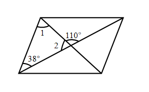
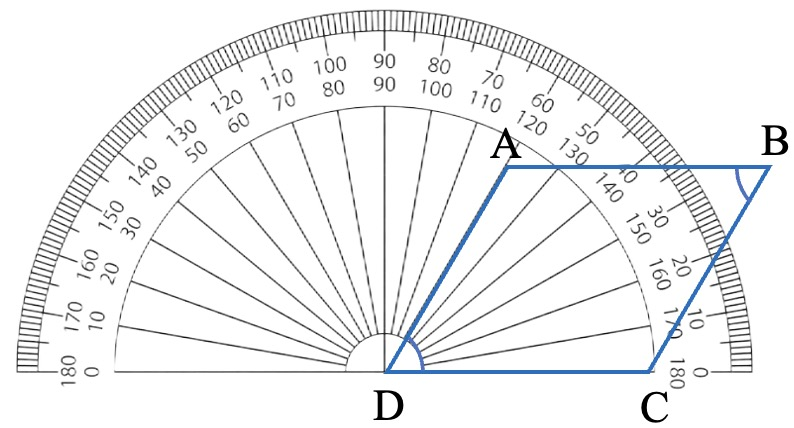

# AVP0673 — Single visual target

We-Math:1305 / We-Math:348 · same type · Geometric markers

## Shared or similar visual information

An arc curved around an angle vertex or center.

## Evidence locations

- Left image: The arc beside the 110-degree label where the two diagonals cross.
- Right image: The gray semicircular rim behind the blue quadrilateral.

## Mathematical meanings

Left image: It identifies the angle at the crossing assigned the 110-degree measure. Right image: It is the graduated edge of the protractor used to read ray directions.

## Same mathematical meanings

no

## Rationales

The left arc isolates one selected vertex angle. The right arc carries many scale graduations, so it provides an instrument for reading different angular positions.

Only the selected target is annotated. AI visual-review draft; not independently double-annotated by humans.
