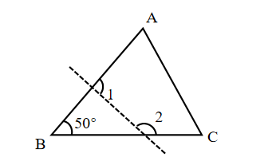
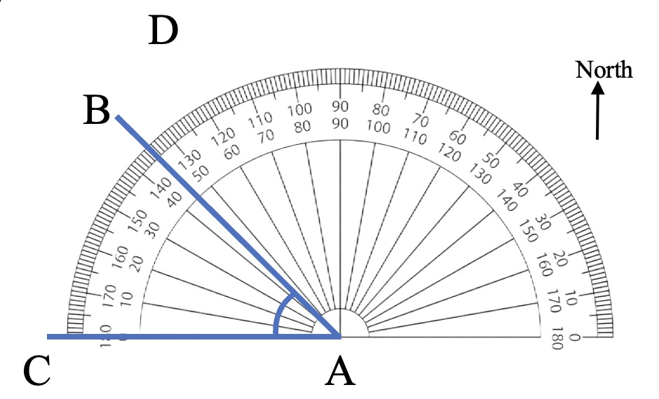

# AVP0674 — Single visual target

We-Math:1307 / We-Math:350 · same type · Geometric markers

## Shared or similar visual information

An arc curved around an angle vertex or center.

## Evidence locations

- Left image: The small arc at B beside the 50-degree label.
- Right image: The broad semicircular rim of the gray protractor centered at A.

## Mathematical meanings

Left image: It identifies the angle at B assigned the 50-degree measure. Right image: It is the graduated angle-reading scale of the protractor.

## Same mathematical meanings

no

## Rationales

The left arc isolates one selected vertex angle. The right arc carries many scale graduations, so it provides an instrument for reading different angular positions.

Only the selected target is annotated. AI visual-review draft; not independently double-annotated by humans.
