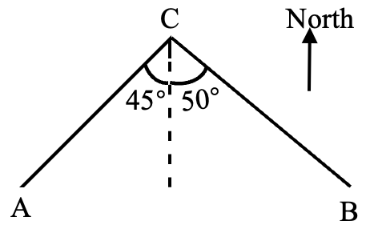
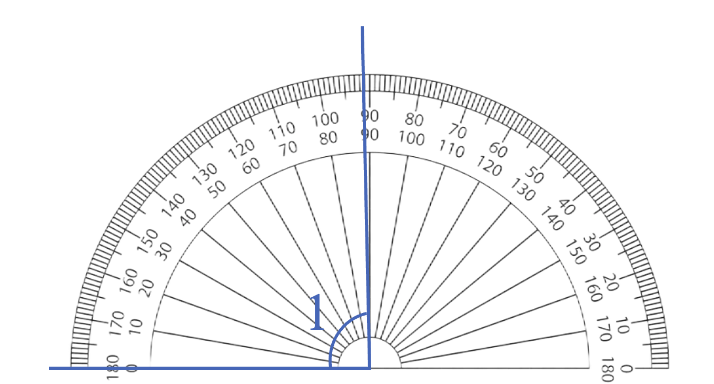

# AVP0675 — Single visual target

We-Math:1574 / We-Math:356 · same type · Geometric markers

## Shared or similar visual information

An arc curved around an angle vertex or center.

## Evidence locations

- Left image: The arc on the left of the dashed reference at C, beside the 45-degree label.
- Right image: The semicircular edge carrying the dense degree divisions.

## Mathematical meanings

Left image: It identifies the angle between CA and the dashed reference ray at C. Right image: It is the outer angular measurement scale of the protractor.

## Same mathematical meanings

no

## Rationales

The left arc isolates one selected vertex angle. The right arc carries many scale graduations, so it provides an instrument for reading different angular positions.

Only the selected target is annotated. AI visual-review draft; not independently double-annotated by humans.
