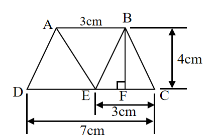
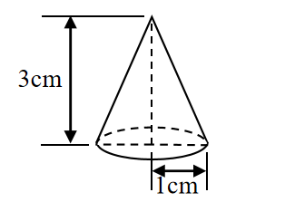

# AVP0676 — Single visual target

We-Math:1415 / We-Math:1261 · different type · Geometric markers

## Shared or similar visual information

An arrow with a head at each end of a measured span.

## Evidence locations

- Left image: The bottom double-ended arrow labeled 7 cm below the whole base.
- Right image: The upright double-ended arrow labeled 3 cm beside the cone.

## Mathematical meanings

Left image: It measures the full horizontal span from D to C. Right image: It measures the height of the cone.

## Same mathematical meanings

yes

## Rationales

The arrowheads align with the two ends of a labeled spatial span in each drawing. The arrows share the role of specifying a finite geometric dimension.

Only the selected target is annotated. AI visual-review draft; not independently double-annotated by humans.
