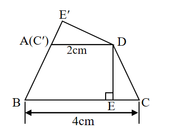
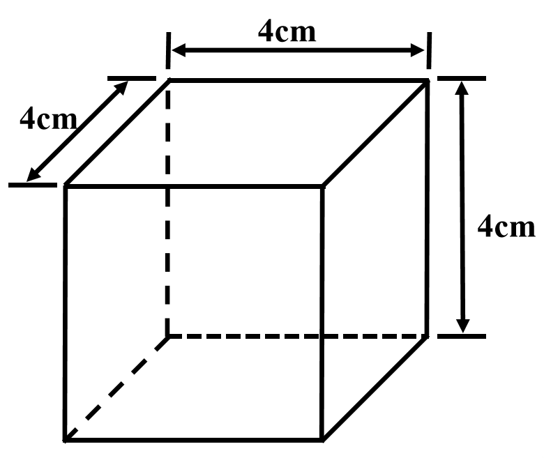

# AVP0678 — Single visual target

We-Math:1248 / We-Math:448 · different type · Geometric markers

## Shared or similar visual information

An arrow with a head at each end of a measured span.

## Evidence locations

- Left image: The horizontal double-ended arrow labeled 4 cm beneath BC.
- Right image: The horizontal double-ended arrow labeled 4 cm above the cuboid.

## Mathematical meanings

Left image: It measures the length of BC. Right image: It measures an edge length of the cuboid.

## Same mathematical meanings

yes

## Rationales

The arrowheads align with the two ends of a labeled spatial span in each drawing. The arrows share the role of specifying a finite geometric dimension.

Only the selected target is annotated. AI visual-review draft; not independently double-annotated by humans.
