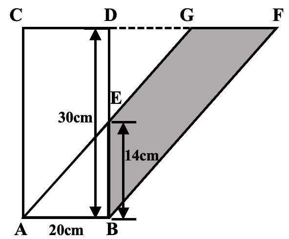
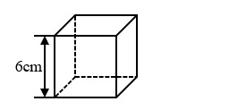

# AVP0680 — Single visual target

We-Math:1521 / We-Math:666 · different type · Geometric markers

## Shared or similar visual information

An arrow with a head at each end of a measured span.

## Evidence locations

- Left image: The vertical double-ended arrow labeled 30 cm to the left of BD.
- Right image: The vertical double-ended arrow labeled 6 cm at the left of the cube.

## Mathematical meanings

Left image: It measures the vertical span from the base level to the top edge. Right image: It measures the vertical edge length of the cube.

## Same mathematical meanings

yes

## Rationales

The arrowheads align with the two ends of a labeled spatial span in each drawing. The arrows share the role of specifying a finite geometric dimension.

Only the selected target is annotated. AI visual-review draft; not independently double-annotated by humans.
