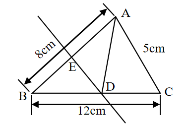
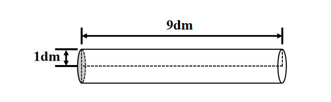

# AVP0681 — Single visual target

We-Math:1524 / We-Math:654 · different type · Geometric markers

## Shared or similar visual information

An arrow with a head at each end of a measured span.

## Evidence locations

- Left image: The oblique double-ended arrow labeled 8 cm outside the left side of the triangle.
- Right image: The long double-ended arrow labeled 9 dm above the horizontal cylinder.

## Mathematical meanings

Left image: It measures the length of the sloping side AB. Right image: It measures the longitudinal length of the cylinder.

## Same mathematical meanings

yes

## Rationales

The arrowheads align with the two ends of a labeled spatial span in each drawing. The arrows share the role of specifying a finite geometric dimension.

Only the selected target is annotated. AI visual-review draft; not independently double-annotated by humans.
