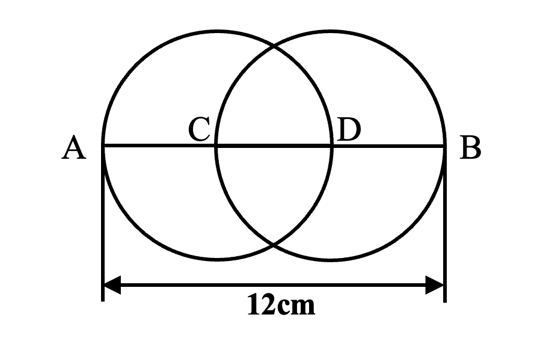
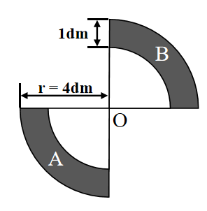

# AVP0683 — Single visual target

We-Math:123 / We-Math:94 · same type · Geometric markers

## Shared or similar visual information

An arrow with a head at each end of a measured span.

## Evidence locations

- Left image: The horizontal double-ended arrow labeled 12 cm below the two overlapping circles.
- Right image: The horizontal dimension arrow labeled r = 4 dm to the left of O.

## Mathematical meanings

Left image: It measures the span from A to B. Right image: It measures the outer radius from O to the outer boundary of the region.

## Same mathematical meanings

yes

## Rationales

The arrowheads align with the two ends of a labeled spatial span in each drawing. The arrows share the role of specifying a finite geometric dimension.

Only the selected target is annotated. AI visual-review draft; not independently double-annotated by humans.
