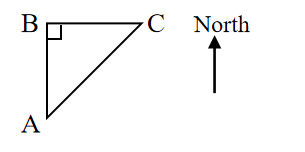
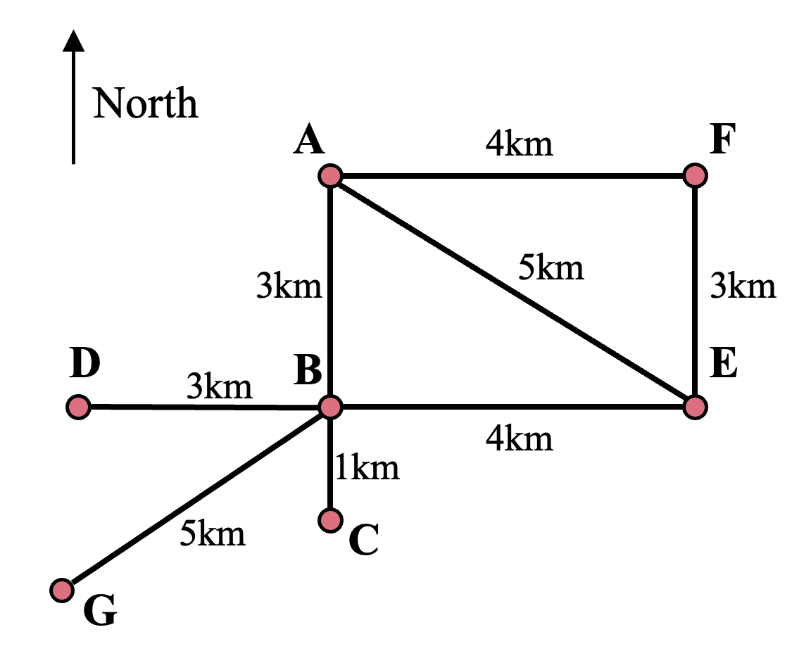

# AVP0684 — Single visual target

We-Math:1251 / We-Math:406 · same type · Geometric markers

## Shared or similar visual information

An upward arrow labeled North.

## Evidence locations

- Left image: The isolated vertical arrow labeled North to the right of the triangle.
- Right image: The upward arrow labeled North above the route on the left.

## Mathematical meanings

Left image: It gives the north direction for interpreting bearings in the diagram. Right image: It provides the north reference direction for interpreting the route.

## Same mathematical meanings

yes

## Rationales

The word North next to each isolated arrow fixes a common directional reference for the surrounding geometry.

Only the selected target is annotated. AI visual-review draft; not independently double-annotated by humans.
