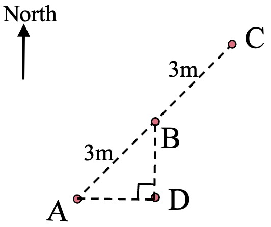
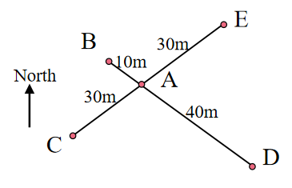

# AVP0685 — Single visual target

We-Math:1403 / We-Math:411 · same type · Geometric markers

## Shared or similar visual information

An upward arrow labeled North.

## Evidence locations

- Left image: The upright arrow labeled North in the upper-left.
- Right image: The arrow labeled North to the left of the crossing routes.

## Mathematical meanings

Left image: It sets north as the upward direction in the route construction. Right image: It gives the compass direction north.

## Same mathematical meanings

yes

## Rationales

The word North next to each isolated arrow fixes a common directional reference for the surrounding geometry.

Only the selected target is annotated. AI visual-review draft; not independently double-annotated by humans.
