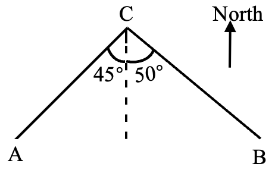
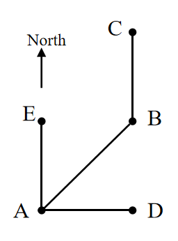

# AVP0686 — Single visual target

We-Math:1574 / We-Math:768 · same type · Geometric markers

## Shared or similar visual information

An upward arrow labeled North.

## Evidence locations

- Left image: The arrow labeled North in the upper-right.
- Right image: The arrow labeled North at the upper-left of the point layout.

## Mathematical meanings

Left image: It sets the upward reference direction as north. Right image: It gives the north orientation for the spatial point diagram.

## Same mathematical meanings

yes

## Rationales

The word North next to each isolated arrow fixes a common directional reference for the surrounding geometry.

Only the selected target is annotated. AI visual-review draft; not independently double-annotated by humans.
