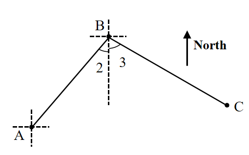
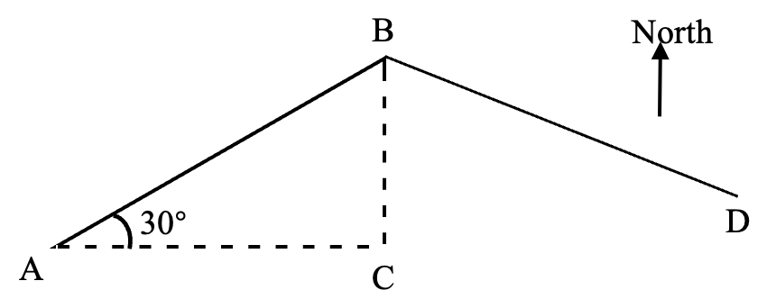

# AVP0687 — Single visual target

We-Math:43 / We-Math:1407 · same type · Geometric markers

## Shared or similar visual information

An upward arrow labeled North.

## Evidence locations

- Left image: The arrow labeled North to the right of the triangle-like route.
- Right image: The isolated arrow labeled North to the right of the route triangle.

## Mathematical meanings

Left image: It identifies north as the direction of the arrow. Right image: It gives the north reference direction for the construction.

## Same mathematical meanings

yes

## Rationales

The word North next to each isolated arrow fixes a common directional reference for the surrounding geometry.

Only the selected target is annotated. AI visual-review draft; not independently double-annotated by humans.
