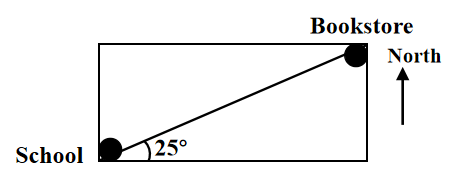
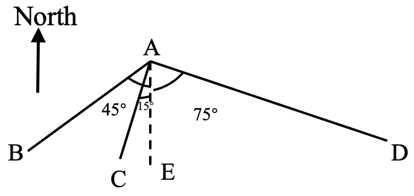

# AVP0688 — Single visual target

We-Math:404 / We-Math:1562 · same type · Geometric markers

## Shared or similar visual information

An upward arrow labeled North.

## Evidence locations

- Left image: The upward arrow labeled North at the right of the school and bookstore map.
- Right image: The isolated upward arrow labeled North at the left of A.

## Mathematical meanings

Left image: It provides the north reference direction for the map. Right image: It supplies the north reference direction for the rays from A.

## Same mathematical meanings

yes

## Rationales

The word North next to each isolated arrow fixes a common directional reference for the surrounding geometry.

Only the selected target is annotated. AI visual-review draft; not independently double-annotated by humans.
