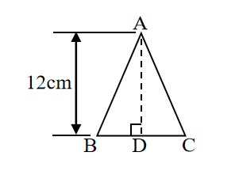
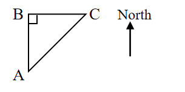

# AVP0689 — Single visual target

We-Math:1097 / We-Math:1251 · same type · Geometric markers

## Shared or similar visual information

An upright arrowhead drawn on a straight shaft.

## Evidence locations

- Left image: The upright double-ended arrow labeled 12 cm to the left of the triangle.
- Right image: The isolated vertical arrow labeled North to the right of the triangle.

## Mathematical meanings

Left image: It measures the triangle height. Right image: It gives the north direction for interpreting bearings in the diagram.

## Same mathematical meanings

no

## Rationales

The left shaft ends at the levels of a finite measured height. The North label on the right sets a compass orientation for the diagram.

Only the selected target is annotated. AI visual-review draft; not independently double-annotated by humans.
