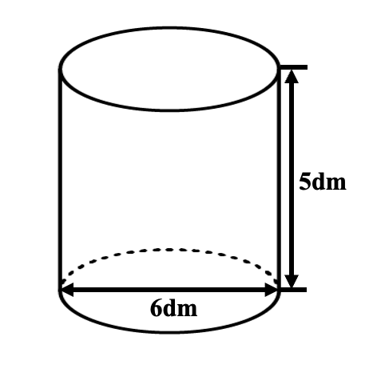
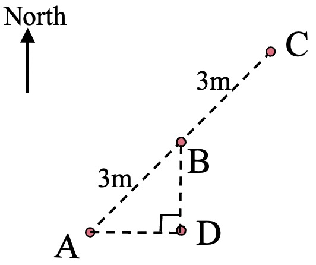

# AVP0690 — Single visual target

We-Math:442 / We-Math:1403 · different type · Geometric markers

## Shared or similar visual information

An upright arrowhead drawn on a straight shaft.

## Evidence locations

- Left image: The upright double-ended arrow labeled 5 dm to the right of the cylinder.
- Right image: The upright arrow labeled North in the upper-left.

## Mathematical meanings

Left image: It measures the height of the cylinder. Right image: It sets north as the upward direction in the route construction.

## Same mathematical meanings

no

## Rationales

The left shaft ends at the levels of a finite measured height. The North label on the right sets a compass orientation for the diagram.

Only the selected target is annotated. AI visual-review draft; not independently double-annotated by humans.
