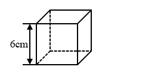
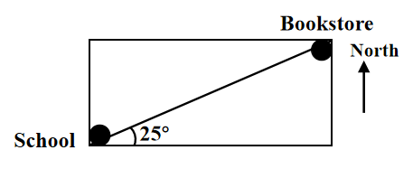

# AVP0691 — Single visual target

We-Math:666 / We-Math:404 · different type · Geometric markers

## Shared or similar visual information

An upright arrowhead drawn on a straight shaft.

## Evidence locations

- Left image: The vertical double-ended arrow labeled 6 cm at the left of the cube.
- Right image: The upward arrow labeled North at the right of the school and bookstore map.

## Mathematical meanings

Left image: It measures the vertical edge length of the cube. Right image: It provides the north reference direction for the map.

## Same mathematical meanings

no

## Rationales

The left shaft ends at the levels of a finite measured height. The North label on the right sets a compass orientation for the diagram.

Only the selected target is annotated. AI visual-review draft; not independently double-annotated by humans.
