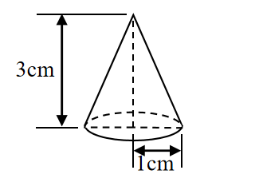
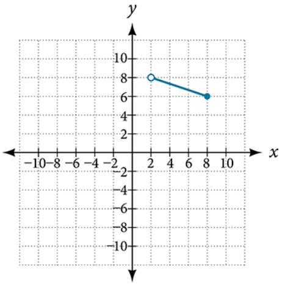

# AVP0692 — Single visual target

We-Math:1261 / MathVerse:482 · different type · Geometric markers

## Shared or similar visual information

An arrowhead terminating a straight line.

## Evidence locations

- Left image: The upright double-ended arrow labeled 3 cm beside the cone.
- Right image: The arrowhead at the top of the axis labeled y.

## Mathematical meanings

Left image: It measures the height of the cone. Right image: It gives the positive vertical coordinate direction.

## Same mathematical meanings

no

## Rationales

The left arrowhead terminates a line spanning a labeled geometric length. The right arrowhead belongs to a coordinate axis and gives its positive direction.

Only the selected target is annotated. AI visual-review draft; not independently double-annotated by humans.
