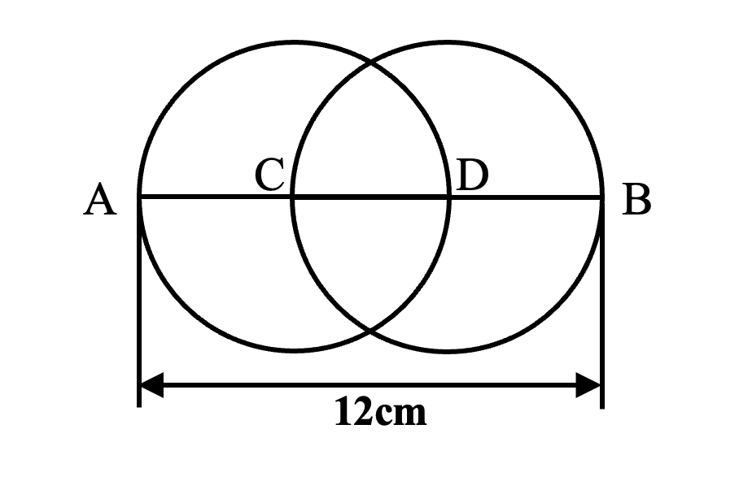
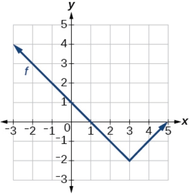

# AVP0694 — Single visual target

We-Math:123 / MathVerse:493 · different type · Geometric markers

## Shared or similar visual information

An arrowhead terminating a straight line.

## Evidence locations

- Left image: The horizontal double-ended arrow labeled 12 cm below the two overlapping circles.
- Right image: The black arrowhead at the right end of the x-axis.

## Mathematical meanings

Left image: It measures the span from A to B. Right image: It gives the positive horizontal coordinate direction.

## Same mathematical meanings

no

## Rationales

The left arrowhead terminates a line spanning a labeled geometric length. The right arrowhead belongs to a coordinate axis and gives its positive direction.

Only the selected target is annotated. AI visual-review draft; not independently double-annotated by humans.
