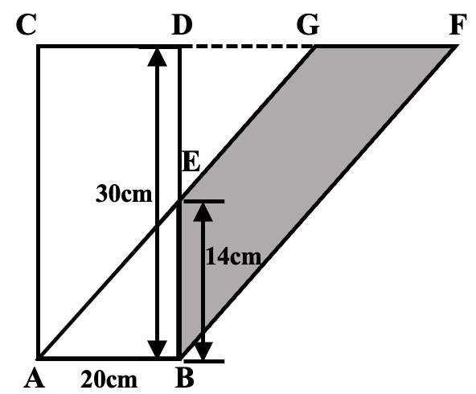
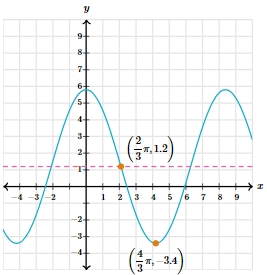

# AVP0695 — Single visual target

We-Math:1521 / MathVerse:535 · different type · Geometric markers

## Shared or similar visual information

An arrowhead terminating a straight line.

## Evidence locations

- Left image: The vertical double-ended arrow labeled 30 cm to the left of BD.
- Right image: The black arrowhead at the top of the y-axis.

## Mathematical meanings

Left image: It measures the vertical span from the base level to the top edge. Right image: It gives the positive vertical coordinate direction.

## Same mathematical meanings

no

## Rationales

The left arrowhead terminates a line spanning a labeled geometric length. The right arrowhead belongs to a coordinate axis and gives its positive direction.

Only the selected target is annotated. AI visual-review draft; not independently double-annotated by humans.
