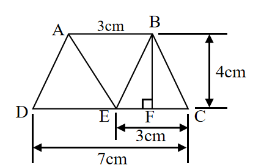

# AVP0696 — Single visual target

We-Math:1415 / MathVerse:544 · different type · Geometric markers

## Shared or similar visual information

A horizontal double-ended arrow.

## Evidence locations

- Left image: The bottom double-ended arrow labeled 7 cm below the whole base.
- Right image: The magenta double-ended arrow across the first two peaks.

## Mathematical meanings

Left image: It measures the full horizontal span from D to C. Right image: It marks the horizontal repetition interval of the waveform.

## Same mathematical meanings

no

## Rationales

The left arrow endpoints align with the bounds of a spatial object. The right endpoints align with successive peaks, so their separation is a repetition interval on the plot.

Only the selected target is annotated. AI visual-review draft; not independently double-annotated by humans.
