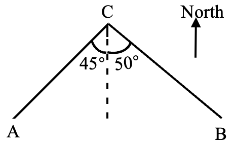

# AVP0698 — Single visual target

We-Math:1574 / MathVerse:535 · different type · Geometric markers

## Shared or similar visual information

An upright arrow pointing toward the top of the diagram.

## Evidence locations

- Left image: The arrow labeled North in the upper-right.
- Right image: The black arrowhead at the top of the y-axis.

## Mathematical meanings

Left image: It sets the upward reference direction as north. Right image: It gives the positive vertical coordinate direction.

## Same mathematical meanings

no

## Rationales

The compass label makes the left arrow a bearing reference. The right arrow sits at the end of the y-axis, where it indicates the direction of increasing ordinate.

Only the selected target is annotated. AI visual-review draft; not independently double-annotated by humans.
