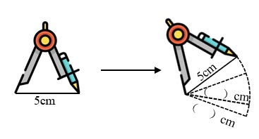
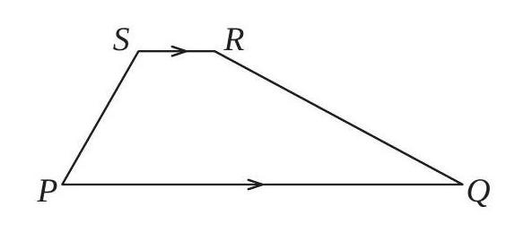

# AVP0699 — Single visual target

We-Math:122 / MathVision:1741 · same type · Geometric markers

## Shared or similar visual information

A right-pointing arrow or chevron along a horizontal direction.

## Evidence locations

- Left image: The right-pointing arrow between the two compass drawings.
- Right image: The matching right-pointing chevrons centered on SR and PQ.

## Mathematical meanings

Left image: It indicates moving from the initial compass setup to the drawn trace. Right image: The paired chevrons state that SR and PQ are parallel.

## Same mathematical meanings

no

## Rationales

The left arrow separates an initial construction from a changed arrangement. The repeated right chevrons sit within two geometric sides and encode their parallelism.

Only the selected target is annotated. AI visual-review draft; not independently double-annotated by humans.
