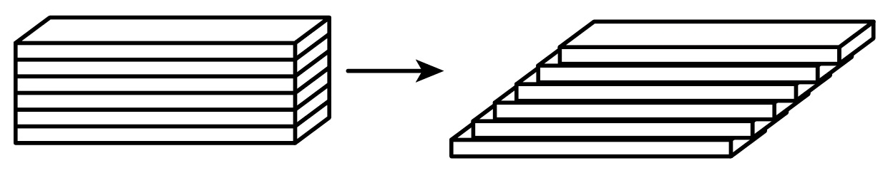
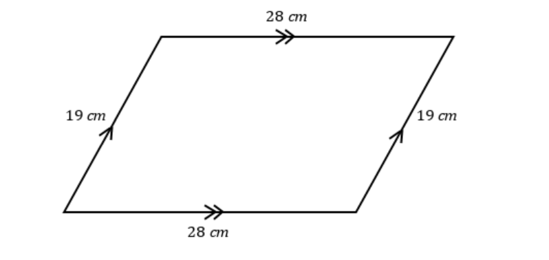

# AVP0700 — Single visual target

We-Math:301 / MathVerse:417 · different type · Geometric markers

## Shared or similar visual information

A right-pointing arrow or chevron along a horizontal direction.

## Evidence locations

- Left image: The right-pointing arrow between a stack and a side-by-side arrangement of slabs.
- Right image: The matching double chevrons across the upper and lower sides.

## Mathematical meanings

Left image: It shows the geometric rearrangement of the same pieces. Right image: The paired chevrons mark the upper and lower sides as parallel.

## Same mathematical meanings

no

## Rationales

The left arrow separates an initial construction from a changed arrangement. The repeated right chevrons sit within two geometric sides and encode their parallelism.

Only the selected target is annotated. AI visual-review draft; not independently double-annotated by humans.
