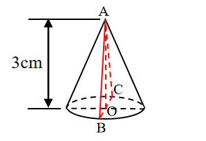
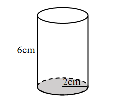

# AVP0701 — Single visual target

We-Math:1087 / We-Math:1422 · same type · Geometric markers

## Shared or similar visual information

Broken strokes along the rear portion of a solid boundary.

## Evidence locations

- Left image: The black dashed arc behind the cone base, just above the solid front rim.
- Right image: The dashed back half of the ellipse at the shaded cylinder base.

## Mathematical meanings

Left image: It represents the hidden rear part of the circular base edge. Right image: It represents the rear base edge concealed by the cylinder wall.

## Same mathematical meanings

yes

## Rationales

In each solid projection the selected edge is at the back of the object. The dashes preserve its position while indicating that it is concealed in the view.

Only the selected target is annotated. AI visual-review draft; not independently double-annotated by humans.
