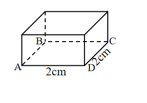
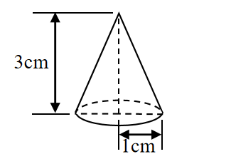

# AVP0702 — Single visual target

We-Math:1259 / We-Math:1261 · same type · Geometric markers

## Shared or similar visual information

Broken strokes along the rear portion of a solid boundary.

## Evidence locations

- Left image: The dashed horizontal edge from B to C inside the box projection.
- Right image: The dashed rear base arc above the solid lower arc of the cone.

## Mathematical meanings

Left image: It represents a hidden rear bottom edge of the box. Right image: It represents the hidden rear portion of the cone base rim.

## Same mathematical meanings

yes

## Rationales

In each solid projection the selected edge is at the back of the object. The dashes preserve its position while indicating that it is concealed in the view.

Only the selected target is annotated. AI visual-review draft; not independently double-annotated by humans.
