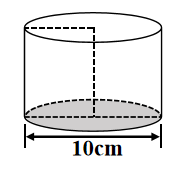
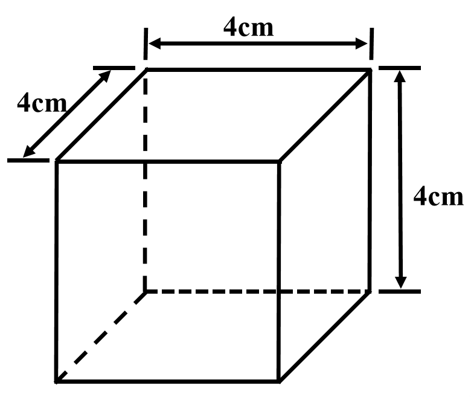

# AVP0703 — Single visual target

We-Math:366 / We-Math:448 · same type · Geometric markers

## Shared or similar visual information

Broken strokes along the rear portion of a solid boundary.

## Evidence locations

- Left image: The dashed rear arc of the lower ellipse above the shaded base.
- Right image: The horizontal dashed edge inside the rear bottom of the cuboid.

## Mathematical meanings

Left image: It represents the obscured portion of the cylinder base circumference. Right image: It represents the hidden rear bottom edge of the cuboid.

## Same mathematical meanings

yes

## Rationales

In each solid projection the selected edge is at the back of the object. The dashes preserve its position while indicating that it is concealed in the view.

Only the selected target is annotated. AI visual-review draft; not independently double-annotated by humans.
