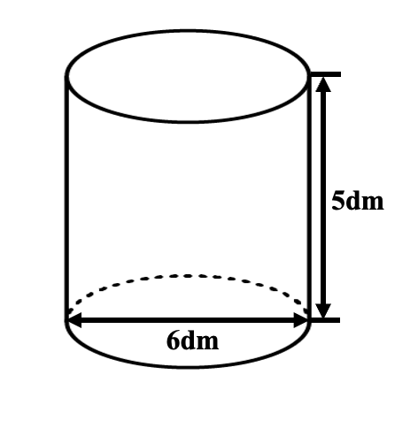
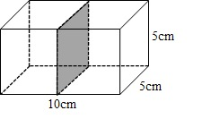

# AVP0704 — Single visual target

We-Math:442 / We-Math:84 · same type · Geometric markers

## Shared or similar visual information

Broken strokes along the rear portion of a solid boundary.

## Evidence locations

- Left image: The dashed curved half of the bottom ellipse.
- Right image: The dashed horizontal segment along the lower back edge of the outer box.

## Mathematical meanings

Left image: It represents the hidden rear half of the cylinder base rim. Right image: It represents the occluded rear bottom edge of the full box.

## Same mathematical meanings

yes

## Rationales

In each solid projection the selected edge is at the back of the object. The dashes preserve its position while indicating that it is concealed in the view.

Only the selected target is annotated. AI visual-review draft; not independently double-annotated by humans.
