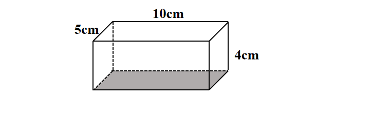
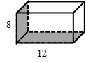

# AVP0705 — Single visual target

We-Math:623 / We-Math:265 · same type · Geometric markers

## Shared or similar visual information

Broken strokes along the rear portion of a solid boundary.

## Evidence locations

- Left image: The dashed segment along the far side of the gray bottom face.
- Right image: The dashed rear bottom edge bordering the shaded base.

## Mathematical meanings

Left image: It represents the hidden rear bottom edge of the cuboid. Right image: It represents an occluded lower edge of the box.

## Same mathematical meanings

yes

## Rationales

In each solid projection the selected edge is at the back of the object. The dashes preserve its position while indicating that it is concealed in the view.

Only the selected target is annotated. AI visual-review draft; not independently double-annotated by humans.
