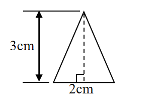
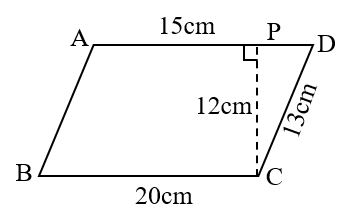

# AVP0707 — Single visual target

We-Math:1426 / We-Math:1532 · same type · Geometric markers

## Shared or similar visual information

A dashed segment ending at a right-angle box.

## Evidence locations

- Left image: The vertical dashed segment dropping from the apex to the base.
- Right image: The vertical dashed segment PC meeting AD at a square.

## Mathematical meanings

Left image: It constructs the perpendicular height from the apex to the base. Right image: It constructs the perpendicular distance from C to AD.

## Same mathematical meanings

yes

## Rationales

Each dashed construction joins a vertex to a base or side and reaches it at a marked right angle. The dashes identify an auxiliary perpendicular height.

Only the selected target is annotated. AI visual-review draft; not independently double-annotated by humans.
