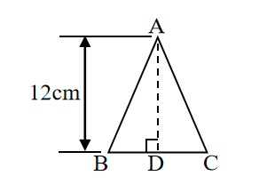
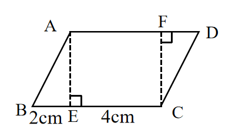

# AVP0708 — Single visual target

We-Math:1097 / We-Math:223 · same type · Geometric markers

## Shared or similar visual information

A dashed segment ending at a right-angle box.

## Evidence locations

- Left image: The dashed segment AD ending at the right-angle box on BC.
- Right image: The left dashed segment AE ending at the square on BC.

## Mathematical meanings

Left image: It constructs the perpendicular height from A to BC. Right image: It constructs the perpendicular separation from A to BC.

## Same mathematical meanings

yes

## Rationales

Each dashed construction joins a vertex to a base or side and reaches it at a marked right angle. The dashes identify an auxiliary perpendicular height.

Only the selected target is annotated. AI visual-review draft; not independently double-annotated by humans.
