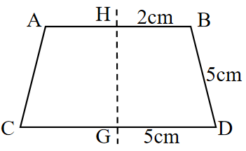
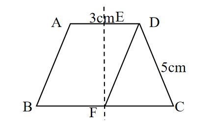

# AVP0711 — Single visual target

We-Math:116 / We-Math:118 · same type · Geometric markers

## Shared or similar visual information

A vertical line drawn as a sequence of short broken strokes.

## Evidence locations

- Left image: The vertical dashed line through H and G.
- Right image: The vertical dashed line through E and F in the trapezoid.

## Mathematical meanings

Left image: It marks the reflection axis of the symmetric trapezoid. Right image: It marks the line of symmetry of the outer trapezoid.

## Same mathematical meanings

yes

## Rationales

The vertical line locates the mirror axis in each reflection construction. The displayed figure may already include both halves or show the original figure beside the line.

Only the selected target is annotated. AI visual-review draft; not independently double-annotated by humans.
