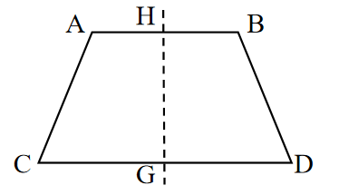
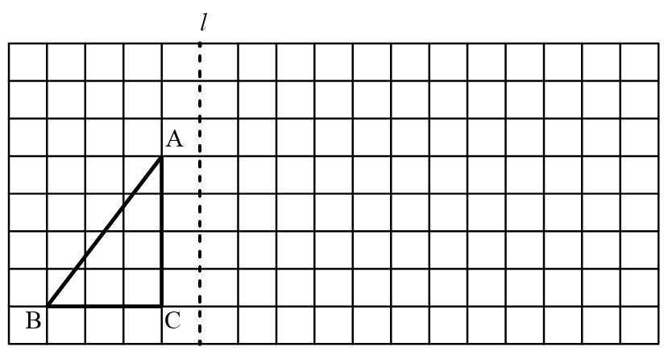

# AVP0712 — Single visual target

We-Math:117 / We-Math:392 · same type · Geometric markers

## Shared or similar visual information

A vertical dashed line.

## Evidence locations

- Left image: The vertical dashed line HG through the center of the trapezoid.
- Right image: The vertical dashed line marked l on the grid.

## Mathematical meanings

Left image: The line is the symmetry axis of the trapezoid. Right image: The line is the axis of reflection for triangle ABC.

## Same mathematical meanings

yes

## Rationales

Both images use the mark in the same way: the dashed line is the axis used to reflect a geometric figure.

Only the selected target is annotated. AI visual-review draft; not independently double-annotated by humans.
