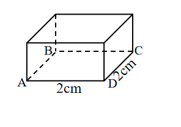
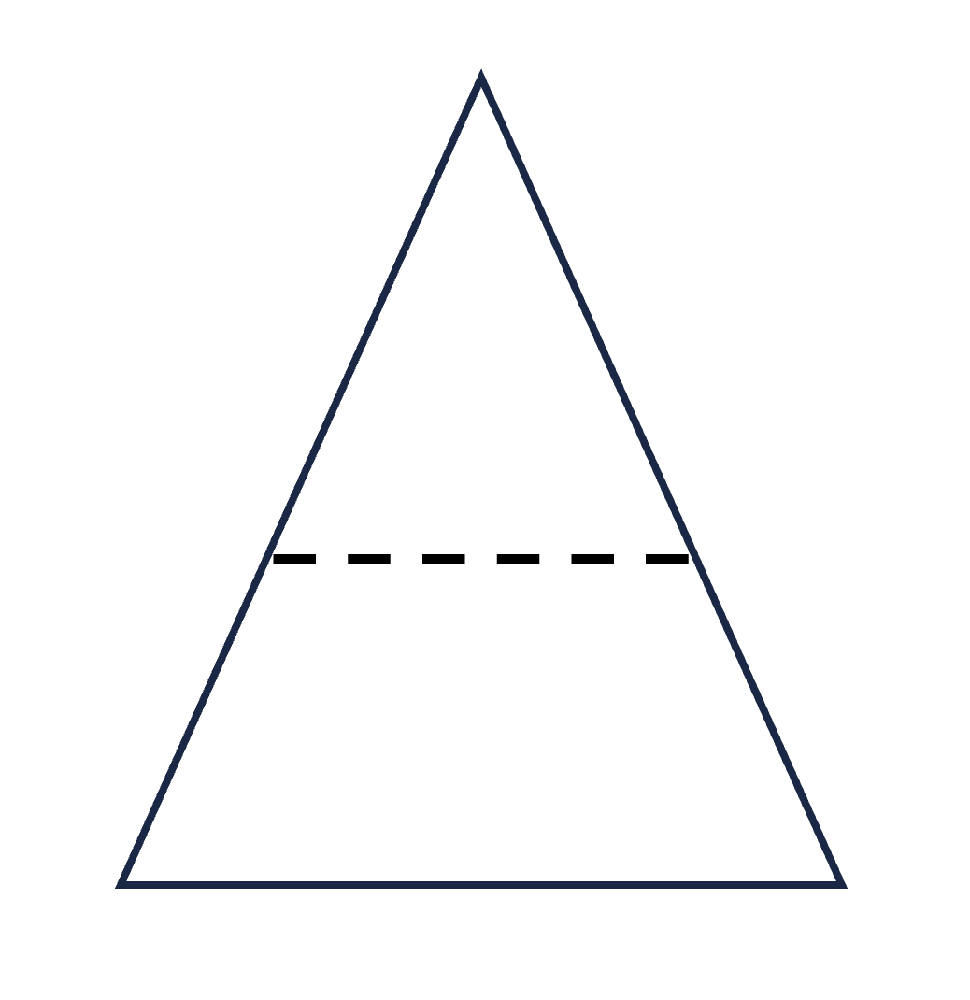

# AVP0713 — Single visual target

We-Math:1259 / We-Math:792 · different type · Geometric markers

## Shared or similar visual information

A straight line made of separated strokes.

## Evidence locations

- Left image: The dashed horizontal edge from B to C inside the box projection.
- Right image: The dashed horizontal line joining the two sloping sides of the triangle.

## Mathematical meanings

Left image: It represents a hidden rear bottom edge of the box. Right image: It partitions the plane triangle into an upper triangle and a lower region.

## Same mathematical meanings

no

## Rationales

The left dashes trace a concealed boundary of a solid. The right stroke lies in a visible construction or subdivision. It partitions the plane triangle into an upper triangle and a lower region.

Only the selected target is annotated. AI visual-review draft; not independently double-annotated by humans.
