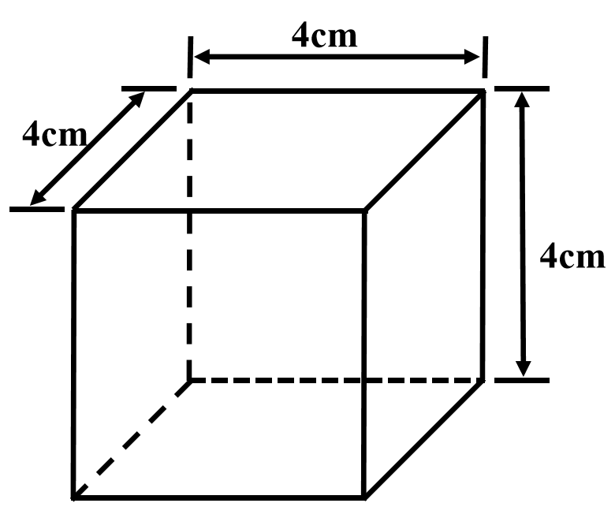
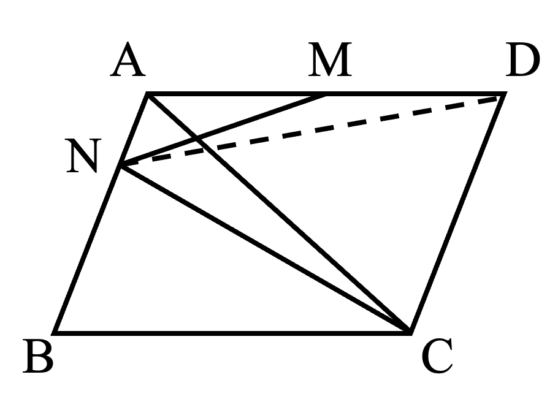

# AVP0714 — Single visual target

We-Math:448 / We-Math:1204 · different type · Geometric markers

## Shared or similar visual information

A straight line made of separated strokes.

## Evidence locations

- Left image: The horizontal dashed edge inside the rear bottom of the cuboid.
- Right image: The dashed segment from N to D across the parallelogram.

## Mathematical meanings

Left image: It represents the hidden rear bottom edge of the cuboid. Right image: It is an internal construction joining two points of the plane figure.

## Same mathematical meanings

no

## Rationales

The left dashes trace a concealed boundary of a solid. The right stroke lies in a visible construction or subdivision. It is an internal construction joining two points of the plane figure.

Only the selected target is annotated. AI visual-review draft; not independently double-annotated by humans.
