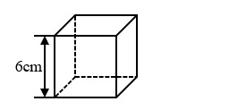
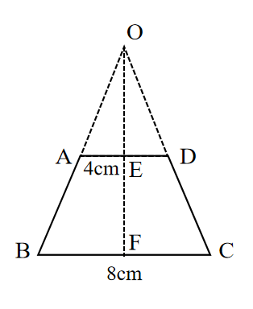

# AVP0715 — Single visual target

We-Math:666 / We-Math:1223 · different type · Geometric markers

## Shared or similar visual information

A straight line made of separated strokes.

## Evidence locations

- Left image: The horizontal dashed edge on the far side of the lower face.
- Right image: The dashed oblique line from O to A above the top base of the trapezoid.

## Mathematical meanings

Left image: It represents the hidden rear bottom edge of the cube. Right image: It extends the oblique side to the apex of a larger triangle.

## Same mathematical meanings

no

## Rationales

The left dashes trace a concealed boundary of a solid. The right stroke lies in a visible construction or subdivision. It extends the oblique side to the apex of a larger triangle.

Only the selected target is annotated. AI visual-review draft; not independently double-annotated by humans.
